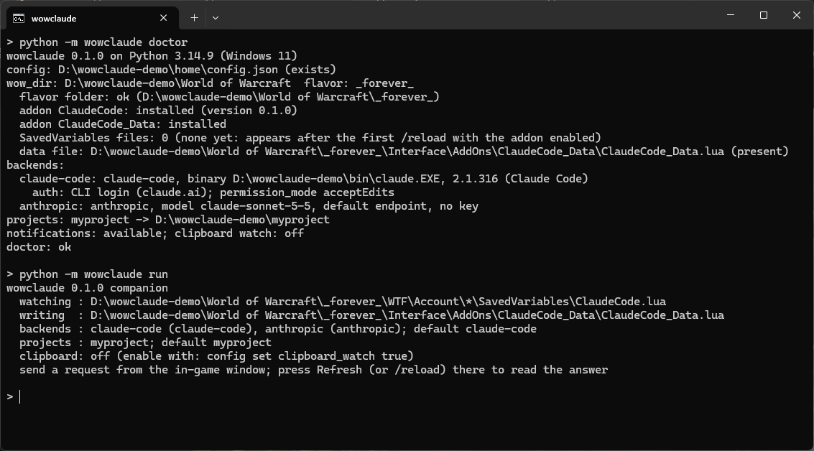

# wow-claude-code

Start, continue and read **Claude Code** sessions from a window **inside World of Warcraft**,
or chat with **any OpenAI-compatible endpoint** (a hosted router, a local model server) from the
same window. Built for **World of Warcraft: Forever** (Interface 16001); the same addon also
lists the current retail and Classic Era interface numbers.

Nothing touches the game process. The addon only reads and writes its own SavedVariables, and
the desktop companion only reads those files and writes one Lua file into its own addon folder:
the same pattern as the WeakAuras Companion and the TradeSkillMaster desktop app.

```
+-----------------------------+            +---------------------------------------+
|  World of Warcraft          |            |  wowclaude companion (your PC)        |
|                             |  /reload   |                                       |
|  ClaudeCode addon --------- | ---------> |  reads  WTF/.../SavedVariables/       |
|   prompt, project, backend  |  (file)    |         ClaudeCode.lua                |
|                             |            |  runs   claude -p ... / HTTP chat     |
|  ClaudeCode_Data addon <--- | <--------- |  writes Interface/AddOns/             |
|   sessions, transcripts     |  /reload   |         ClaudeCode_Data/              |
+-----------------------------+            |         ClaudeCode_Data.lua           |
                                           +---------------------------------------+
```

A request leaves the game when the UI reloads (Send does that for you), and the answer comes
back on the next reload (press Refresh). Optionally, with the clipboard watcher turned on, a
request can also leave the game with a single Ctrl+C and no reload.

**Status:** 0.1.1, early release. The companion, its three backends and both file formats are
exercised by real runs on Windows; the in-game window is new. Please report what breaks in
[Issues](https://github.com/dmmdea/wow-claude-code/issues).

## Screenshots

`doctor` after a fresh install, then the companion's banner:



## What you need

- World of Warcraft: Forever, retail, or Classic Era (Windows or macOS).
- Python 3.10 or newer. No packages are installed; the companion uses only the standard library.
- For the Claude Code backend: the [Claude Code CLI](https://docs.claude.com/en/docs/claude-code/overview)
  installed and either logged in (`claude`, then `/login`) or an `ANTHROPIC_API_KEY` in your environment.
- For other backends: an API key for the endpoint you choose, or a local server that needs none.

## Install

1. Download the repository (Code > Download ZIP, or `git clone`) and open a terminal in it.
2. Write the config. The companion looks for your install folder through Battle.net's own
   records; pass `--wow-dir` when it cannot find it.

   ```
   python -m wowclaude init --flavor forever --project myproject=C:\path\to\a\project
   ```

   Without `--non-interactive` the command asks for anything missing.
3. Copy the two addon folders into the game:

   ```
   python -m wowclaude install
   ```

   If the game is running, restart it once: the client lists new addons only at launch.
4. Check everything:

   ```
   python -m wowclaude doctor
   ```

5. Keep the companion running while you play:

   ```
   python -m wowclaude run
   ```

Prefer a command on your PATH? `pipx install .` or `uv tool install .` from the repository folder
gives you `wowclaude` instead of `python -m wowclaude`.

**Update:** pull (or download) the new version and run `python -m wowclaude install` again; the
companion's data file is kept. **Uninstall:** `python -m wowclaude uninstall` removes exactly
the two addon folders; delete `~/.wowclaude` yourself if you want the config and state gone too.

## In the game

- When you log in, the addon says in chat how to open it, and it puts a small note-icon button on
  the minimap. Click the button, or type `/claude` (or `/cc`), to toggle the window. There is also
  a keybinding under *Options > Keybindings > AddOns* and an entry in the addon compartment (the
  puzzle-piece menu by the minimap). Drag the button to move it; `/claude minimap` hides it.
- Pick a **Project** (a folder on your PC for Claude Code sessions) and a **Backend**, type a
  prompt, press **Send**. Send stores the request and reloads the UI so it reaches the companion.
- Press **Refresh** whenever you want to read what the companion has written so far. Your PC also
  shows a desktop notification when a turn finishes.
- **New session** starts a fresh conversation; selecting a session on the left and sending
  continues it (Claude Code sessions are resumed by their session id).
- **Stop** asks the companion to end the running turn. **Copy** puts the request on your clipboard
  as a single line for the clipboard watcher (see below).
- Slash commands: `/claude send <prompt>`, `/claude copy <prompt>`, `/claude new`, `/claude stop`,
  `/claude reload`, `/claude status`, `/claude minimap` (`/claude minimap reset` puts the button back).

## Backends

Backends live under `backends` in the config and are picked per request in the window.

| type | what it is | needs |
|---|---|---|
| `claude-code` | the installed Claude Code CLI in print mode, inside the chosen project folder; multi-turn by session id | CLI logged in, or `api_key_env` / `api_key_file` |
| `openai` | any OpenAI-compatible `/chat/completions` endpoint, streamed; the conversation is kept by the companion | `base_url`, `model`, usually `api_key_env` |
| `anthropic` | the Anthropic Messages API directly, streamed | `model`, `api_key_env` or `api_key_file` |

Add a hosted router with the bundled preset, then set the model id you want (the preset ships a
placeholder):

```
python -m wowclaude config add-backend router openrouter
python -m wowclaude config set backends.router.model your-model-id:free
python -m wowclaude config set default_backend router
```

Point the same type at a local server instead (see `docs/backends.md` for more examples):

```
python -m wowclaude config set backends.local '{"type":"openai","base_url":"http://127.0.0.1:8080/v1","model":"local-model"}'
```

Keys are never written to the config. Each backend names the environment variable
(`api_key_env`) or a file (`api_key_file`) that holds its key; the companion reads it at run time
and hands it only to the request or the CLI process.

## Configuration

`python -m wowclaude config path` shows the file (`~/.wowclaude/config.json`, or `$WOWCLAUDE_HOME`).
`config show` prints it with key sources named and no key material. `config set KEY VALUE`
accepts dotted keys and JSON values.

| key | default | meaning |
|---|---|---|
| `wow_dir` | detected | the folder holding `_forever_`, `_retail_`, ... |
| `flavor` | `_forever_` | which client to install into and watch |
| `projects` | `{}` | name -> folder for Claude Code sessions |
| `default_project`, `default_backend` | | what a request uses when the window has no pick |
| `backends.<name>.permission_mode` | `acceptEdits` | Claude Code permission mode; prompts are auto-denied in print mode, so `default` behaves like read-mostly and `bypassPermissions` runs everything (your call) |
| `backends.<name>.allowed_tools` | `[]` | extra `--allowedTools` entries |
| `backends.<name>.max_budget_usd` | `5.0` | per-turn cap, applied only when a key is used (a CLI login is not billed per turn) |
| `backends.<name>.extra_args` | `[]` | extra CLI flags, for example `["--bare"]` for a leaner session |
| `clipboard_watch` | `false` | opt in to the clipboard send path |
| `toast` | `true` | desktop notification when a turn finishes |
| `poll_interval_sec` | `1.0` | how often the SavedVariables files are checked |

## The clipboard send path (opt-in)

A reload per send is the honest cost of a bridge that never touches the game. If you would
rather not reload, turn on `clipboard_watch`. The window then shows the request as one selected
line; press Ctrl+C and the companion picks it up immediately. The watcher reads the clipboard
only when its sequence number changes, acts only on text that starts with `CLAUDECODE-WOW:1:`,
and keeps nothing else. It is off by default because reading the clipboard is a privacy decision
you should make yourself.

## Safety

Everything here is designed around not giving Blizzard any reason to look at your account:

- No injection, no hooks, no process handle, no screen or pixel reading, no keystrokes sent to
  the game, no overlay, nothing placed beside the game executable. The companion is a file
  watcher and a file writer.
- The addon uses only the public addon API; it never automates gameplay. A reload happens only
  when you click Send or Refresh.
- The companion writes to exactly two folders under `Interface/AddOns` and to its own
  `~/.wowclaude`. `uninstall` removes exactly those two folders.
- Keys never enter the game, the addon folders, logs, or the data file. `doctor` and
  `config show` never print key material.
- Anything you install in the game can write to any addon's SavedVariables, including this
  addon's request queue. The companion prints every request before it runs it; keep the
  permission mode you are comfortable with, and keep the budget cap when you use an API key.

`docs/safety.md` goes through the EULA language and the reasoning in detail.

## Troubleshooting

- *Nothing shows in the game*: type `/claude status`. An answer with a version means the addon
  is loaded, and `/claude` opens the window. If the game does not know the command, the addon did
  not load: check that both entries are ticked in the AddOns list, and restart the game if you
  installed while it was running.
- *The addon says a part "failed to build"*: that line is the Lua error. Please open an issue
  with it.
- *The window says "no companion data yet"*: run `python -m wowclaude run`, then press Refresh.
- *A request never leaves the game*: Send needs the reload to go through; in combat the client
  does not reload, so press Refresh after the fight. `doctor` shows how many requests are waiting.
- *`claude` not found*: install the Claude Code CLI, or set `backends.claude-code.claude_bin` to
  its full path.
- *Tool calls are denied*: print mode cannot ask you for permission. Raise `permission_mode`, add
  `allowed_tools`, or run the task from a terminal.
- *The addon is not listed in the game*: the client scans `Interface/AddOns` at launch; restart
  the game after `install`.

## Development

- `python tools/lua_smoke.py` runs the addon's Lua under LuaJIT with a small client shim
  (needs `pip install lupa`).
- `luacheck addon --config .luacheckrc` lints the addon; every client global it may touch is
  listed by name in `.luacheckrc`.
- `python -m wowclaude selfcheck` exercises the file formats without the game.

Layout: `addon/ClaudeCode` (the window), `addon/ClaudeCode_Data` (the bridge file the companion
writes), `wowclaude/` (the companion), `docs/` (architecture, protocol, backends, safety).

More detail: [architecture](docs/architecture.md), [bridge protocol](docs/bridge-protocol.md),
[backends](docs/backends.md), [safety and the game's rules](docs/safety.md),
[changelog](CHANGELOG.md).

Issues and pull requests are welcome. Before a PR, run the luacheck and `lua_smoke` checks above
and `python -m wowclaude selfcheck`; CI runs the same three.

## Not affiliated

World of Warcraft and Battle.net are trademarks of Blizzard Entertainment. Claude and Claude
Code are trademarks of Anthropic. This project is not affiliated with or endorsed by either.

## License

Apache-2.0. See `LICENSE`.
