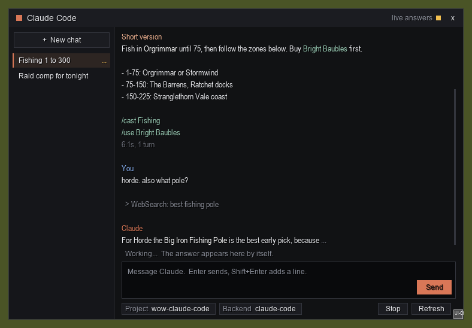
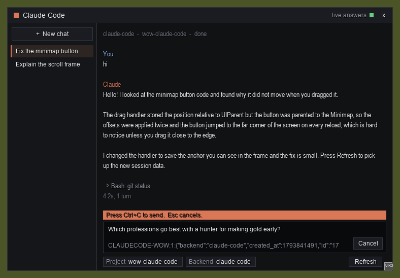

# wow-claude-code

Start, continue and read **Claude Code** sessions from a window **inside World of Warcraft**,
or chat with **any OpenAI-compatible endpoint** (a hosted router, a local model server) from the
same window. Built for **World of Warcraft: Forever** (Interface 16001); the same addon also
lists the current retail and Classic Era interface numbers.

Nothing touches the game process. The addon uses only the public addon API. The desktop companion
reads the game's SavedVariables file and the one line you copy yourself with Ctrl+C, and it writes
Lua files into its own addon folders. Reading SavedVariables and writing addon files is the pattern
of the WeakAuras Companion and the TradeSkillMaster desktop app. Writing those files while the game
runs, so answers arrive without a reload, goes one step further: read [Safety](#safety) before you
turn it on.

```
+-----------------------------+            +---------------------------------------+
|  World of Warcraft          |            |  wowclaude companion (your PC)        |
|                             |  Ctrl+C    |                                       |
|  ClaudeCode addon --------- | ---------> |  reads  the line you copied           |
|   window, chats, prompt     |  one line  |  runs   claude -p ... / HTTP chat     |
|                             |            |                                       |
|  ClaudeCode_Live### <------ | <--------- |  writes Interface/AddOns/             |
|   load-on-demand slots      |   files    |         ClaudeCode_Data/              |
|  ClaudeCode_Data addon      |            |         ClaudeCode_Live###/Live.lua   |
+-----------------------------+            +---------------------------------------+
```

You type in the window and press Enter. The window selects one line, you press Ctrl+C, and the
companion takes that line from the clipboard and runs the request. While it works, the companion
keeps writing the answer into the live slot folders. The addon loads one of them, which reads the
file from disk at that moment, and the answer appears in the window with no reload. Both halves
have a fallback: with the clipboard path off, a send reloads the UI as in 0.1; when the live checks
run out, the Refresh button becomes Reload UI.

**Status:** 0.2.1, early release. The companion, its three backends and the file formats are
exercised by real runs on Windows. The window and the live channel are new in this release.
Please report what breaks in [Issues](https://github.com/dmmdea/wow-claude-code/issues).

## Screenshots

The window while an answer streams in:



A message staged, waiting for Ctrl+C:



These two are layout previews rendered from the addon's own UI code outside the game, so the
fonts in the game differ.

`doctor` after a fresh install, then the companion's banner (from 0.1; the current commands print
a few more lines):


## What you need

- World of Warcraft: Forever, retail, or Classic Era (Windows or macOS).
- Python 3.10 or newer. No packages are installed; the companion uses only the standard library.
- For the Claude Code backend: the [Claude Code CLI](https://docs.claude.com/en/docs/claude-code/overview)
  installed and either logged in (`claude`, then `/login`) or an `ANTHROPIC_API_KEY` in your environment.
- For other backends: an API key for the endpoint you choose, or a local server that needs none.

## Install

1. Download the repository (Code > Download ZIP, or `git clone`) and open a terminal in it.
2. Write the config. The companion looks for your install folder through Battle.net's own
   records; pass `--wow-dir` when it cannot find it.

   ```
   python -m wowclaude init --flavor forever --project myproject=C:\path\to\a\project
   ```

   Without `--non-interactive` the command asks for anything missing, including whether to send
   from the game without a reload (the clipboard path; the default answer is yes on a first run,
   and a later `init` keeps what the config says). If the shell you run it in
   sets `CLAUDE_CONFIG_DIR` or `CLAUDE_SECURESTORAGE_CONFIG_DIR`, `init` saves them for the Claude
   Code backend; see [docs/backends.md](docs/backends.md).
3. Copy the addon folders into the game:

   ```
   python -m wowclaude install
   ```

   This installs `ClaudeCode` and `ClaudeCode_Data`, and it also creates the live slot folders
   `ClaudeCode_Live001`, `ClaudeCode_Live002` and so on (200 by default). The game lists addon
   folders only when it starts and on a `/reload`, so the slots have to exist before the game can
   load one. Each live check in the game uses one slot, which is why there are many.
4. In the game, type `/reload` once (or start the game). If the window still shows "Type /reload
   once to turn on live answers.", restart the game once.
5. Check everything:

   ```
   python -m wowclaude doctor
   ```

6. Keep the companion running while you play:

   ```
   python -m wowclaude run
   ```

   One companion at a time: a second `run` stops with a message instead of answering every
   request twice.

Prefer a command on your PATH? `pipx install .` or `uv tool install .` from the repository folder
gives you `wowclaude` instead of `python -m wowclaude`.

**Update:** pull (or download) the new version and run `python -m wowclaude install` again; the
companion's data file is kept. **Uninstall:** `python -m wowclaude uninstall` removes the
`ClaudeCode` and `ClaudeCode_Data` folders and the slot folders that `install` created (they carry
a marker line in their `.toc` file); delete `~/.wowclaude` yourself if you want the config and
state gone too.

## In the game

- When you log in, the addon says in chat how to open it, and it puts a small note-icon button on
  the minimap. Click the button, or type `/claude` (or `/cc`), to toggle the window. There is also
  a keybinding under *Options > Keybindings > AddOns* and an entry in the addon compartment (the
  puzzle-piece menu by the minimap). Drag the button to move it; `/claude minimap` hides it.
- The window is a flat dark panel. The chat list is on the left, with **+ New chat** at the top;
  select a chat and send to continue it (Claude Code sessions are resumed by their session id). The
  transcript on the right labels each turn **You** or **Claude** and colors headings, bold text,
  inline code and code blocks. Drag the corner to resize it.
- Type a message and press Enter. The window stages it and tells you to press Ctrl+C; see
  [Sending without a reload](#sending-without-a-reload-the-clipboard-path). Shift+Enter adds a line.
- A guidance line above the message box says what is happening or what to do next.
- The **Project** chip (a folder on your PC for Claude Code sessions) and the **Backend** chip
  show the current picks; click one to cycle to the next.
- **Stop** appears while the chat on screen is running a turn and asks the companion to end it.
- **Refresh** does one live check. When no live check is left it reads **Reload UI** and reloads.
  See [Live answers](#live-answers).
- The header shows the state of the channel, for example "live answers", "live answers, 12 checks
  left", "answers by reload" or "companion not seen".
- When an answer lands while the window is closed, the addon prints a chat line, plays a soft sound
  (`/claude sound` toggles it) and lights a dot on the minimap button. Your PC also shows a desktop
  notification when a turn finishes.
- Click in the transcript, select text and press Ctrl+C to copy it. A text box of the window that
  has the keyboard lets go of it when you press Esc or click outside the window, so your keys go
  back to the game.
- Slash commands (`/claude` or `/cc`):

  | command | what it does |
  |---|---|
  | `/claude`, `/claude toggle`, `/claude show` | open or close the window |
  | `/claude send <prompt>` | send a prompt the way the window does |
  | `/claude copy <prompt>` | stage a prompt for Ctrl+C, whatever the send mode |
  | `/claude new` | the next prompt starts a new chat |
  | `/claude stop` | ask the companion to end the running turn |
  | `/claude refresh` | one live check, same as the Refresh button |
  | `/claude reload` | reload the UI |
  | `/claude status` | version, queued requests, age of the companion data, send mode, live checks left |
  | `/claude live` | show the live channel state; `/claude live on` and `/claude live off` switch it |
  | `/claude mode` | show how a message leaves the game; `/claude mode auto`, `reload` or `clipboard` sets it (`auto` follows the companion's `clipboard_watch`) |
  | `/claude sound` | turn the answer sound on or off |
  | `/claude minimap` | hide or show the minimap button; `/claude minimap reset` puts it back |

## Live answers

`install` creates the slot folders: small load-on-demand addons with one file each, `Live.lua`. On
every data write the companion puts a small copy of your newest sessions into every slot. When an
answer is pending, the addon asks the client to load the next unused slot with
`C_AddOns.LoadAddOn`. The client reads the file from disk at that moment, and the addon merges what
it finds into the window.

A slot loads once per UI session, so every live check uses one slot, and a `/reload` makes all of
them usable again. The budget is the `live_slots` setting (200 by default, 0 to 400).

- While an answer is pending the addon checks on a slowing schedule: 3, 4, 5, 6, 8, 10, 14, 20,
  25, 30, 35, 40, 50 and 60 seconds apart, then every 60 seconds. A turn of about ten minutes uses
  roughly 20 checks.
- It stops after 8 checks in a row that find nothing new, and it checks nothing while nothing is
  pending. While a turn runs, the companion rewrites its data at least every 20 seconds, so a
  silent stretch means it is not running.
- The Refresh button does one check.
- When 20 or fewer checks are left, the header counts them. When none is left, the button reads
  "Reload UI", the header says "live checks used up, /reload", and answers are read on a `/reload`
  as in 0.1.
- The live copy holds the three newest sessions, each trimmed from the front to about 60 KB. A
  longer chat shows a line saying how many earlier messages appear after a `/reload`.

To turn the feature off, run `python -m wowclaude config set live_slots 0` and then
`python -m wowclaude install`; the slot folders are removed. In the game, `/claude live off` stops
the addon from loading them. Answers are then read on a `/reload` only.

## Backends

Backends live under `backends` in the config and are picked per request in the window.

| type | what it is | needs |
|---|---|---|
| `claude-code` | the installed Claude Code CLI in print mode, inside the chosen project folder; multi-turn by session id | CLI logged in, or `api_key_env` / `api_key_file` |
| `openai` | any OpenAI-compatible `/chat/completions` endpoint, streamed; the conversation is kept by the companion | `base_url`, `model`, usually `api_key_env` |
| `anthropic` | the Anthropic Messages API directly, streamed | `model`, `api_key_env` or `api_key_file` |

Add a hosted router with the bundled preset, then set the model id you want (the preset ships a
placeholder):

```
python -m wowclaude config add-backend router openrouter
python -m wowclaude config set backends.router.model your-model-id:free
python -m wowclaude config set default_backend router
```

Point the same type at a local server instead, one field per command so no shell can mangle the
quotes (see `docs/backends.md` for every field):

```
python -m wowclaude config set backends.local.type openai
python -m wowclaude config set backends.local.base_url http://127.0.0.1:8080/v1
python -m wowclaude config set backends.local.model local-model
```

Keys are never written to the config. Each backend names the environment variable
(`api_key_env`) or a file (`api_key_file`) that holds its key; the companion reads it at run time
and hands it only to the request or the CLI process.

## Configuration

`python -m wowclaude config path` shows the file (`~/.wowclaude/config.json`, or `$WOWCLAUDE_HOME`).
`config show` prints it with key sources named and no key material. `config set KEY VALUE`
accepts dotted keys and JSON values; prefer one plain value per command, because some shells
remove the quotes of a JSON object.

| key | default | meaning |
|---|---|---|
| `wow_dir` | detected | the folder holding `_forever_`, `_retail_`, ... |
| `flavor` | `_forever_` | which client to install into and watch |
| `projects` | `{}` | name -> folder for Claude Code sessions |
| `default_project`, `default_backend` | | what a request uses when the window has no pick |
| `backends.<name>.permission_mode` | `acceptEdits` | Claude Code permission mode; prompts are auto-denied in print mode, so `default` behaves like read-mostly and `bypassPermissions` runs everything (your call) |
| `backends.<name>.allowed_tools` | `[]` | extra `--allowedTools` entries |
| `backends.<name>.max_budget_usd` | `5.0` | per-turn cap, applied only when a key is used (a CLI login is not billed per turn) |
| `backends.<name>.extra_args` | `[]` | extra CLI flags, for example `["--bare"]` for a leaner session |
| `backends.<name>.env` | `{}` | `claude-code` only: environment variables set for the CLI process, for a login kept outside the default folder; names that look like credentials, and values that carry one, are refused |
| `clipboard_watch` | `false` | the clipboard send path; `init` asks, and on a first run the default answer is yes |
| `live_slots` | `200` | how many live slot folders `install` creates, 0 to 400; 0 turns live answers off |
| `toast` | `true` | desktop notification when a turn finishes |
| `poll_interval_sec` | `1.0` | how often the SavedVariables files are checked |

## Sending without a reload (the clipboard path)

A SavedVariables file is written only when the UI reloads, so a bridge that never touches the game
needs another way out for a message. The clipboard path is that way, and it is on when the config
has `clipboard_watch` true.

1. Type a message and press Enter.
2. The window stages it. One selected line, the envelope (`CLAUDECODE-WOW:1:{json}`), has the
   keyboard, and the guidance line says "Press Ctrl+C to send. Esc cancels."
3. Press Ctrl+C. The game copies the line with its own copy, and the companion's clipboard watcher
   takes it when it carries this install's nonce.

While the line is selected it has the keyboard, like any text box in the game. Esc, the Cancel
button, or a click away from it (outside the window, on the window's background, on the transcript
or on another chat) takes the message back into the box and gives the keyboard back to the game.
Staging a second request takes the first one back. Shift+Enter adds a line.

The watcher reads the clipboard only when its sequence number changes, acts only on text that
starts with `CLAUDECODE-WOW:1:` and carries this install's nonce, and keeps nothing else. It never
writes to the clipboard and never pastes into the game. The window learns the setting and the nonce
from the companion's data, so start the companion and let the game load its data once (Refresh or
`/reload`) before the first send.

`init` asks about the clipboard path and has `--clipboard` and `--no-clipboard`. The default answer
is yes on a first run; on a later run it is what the config already says. When `init` does not ask
(`--non-interactive`), the value stays as it is, which is off in a new config unless you pass
`--clipboard`. `init` ends by printing `Clipboard send path: on` or `off`. To change it later run
`python -m wowclaude config set clipboard_watch true` and restart the companion. With the path off,
a send reloads the UI as in 0.1, and the window says so above the message box.

## Safety

Everything here is designed around not giving Blizzard any reason to look at your account, and
none of it is a promise that the game's rules allow it:

- No injection, no hooks, no process handle, no screen or pixel reading, no keystrokes sent to
  the game, no overlay, nothing placed beside the game executable.
- The addon uses only the public addon API. It never automates gameplay, never reloads the UI by
  itself and never sends input. Its only repeating timer looks at its own live slots while an
  answer is pending; the few one-shot timers finish what a key press or a redraw started (letting
  go of the keyboard after Ctrl+C, scrolling to the newest line).
- The companion writes to the two addon folders, the live slot folders and its own `~/.wowclaude`.
  `uninstall` removes the two addon folders and the slot folders `install` created.
- **The live slots go further than 0.1 did.** While the game runs, the companion rewrites one file
  inside each of its own slot addon folders, and the addon loads one through `C_AddOns.LoadAddOn`.
  The idea is not ours: [chelinho139/wow-ai](https://github.com/chelinho139/wow-ai) and other
  public projects use a slot pool for this client. We found no statement from Blizzard about it,
  and a 2014 forum thread has two long-time members calling an external program that changes
  addon data while the game runs against the Terms of Use. That is forum opinion, not Blizzard
  policy, but this project cannot promise the technique is allowed. If that matters to you, turn it
  off (see [Live answers](#live-answers)); answers are then read on a `/reload`, like any addon
  updater that changes files between reloads.
- The clipboard path: you press Ctrl+C yourself; the companion reads the clipboard only for lines
  that start with the prefix and carry this install's nonce, and it never writes to the clipboard
  or pastes into the game.
- Keys never enter the game, the addon folders, logs, or the data file. `doctor` and
  `config show` never print key material.
- Anything you install in the game can write to any addon's SavedVariables, including this
  addon's request queue. The companion prints every request before it runs it; keep the
  permission mode you are comfortable with, and keep the budget cap when you use an API key.

[docs/safety.md](docs/safety.md) goes through the EULA language and the reasoning in detail.

## Troubleshooting

- *Nothing shows in the game*: type `/claude status`. An answer with a version means the addon
  is loaded, and `/claude` opens the window. If the game does not know the command, the addon did
  not load: check that both entries are ticked in the AddOns list, type `/reload`, and restart the
  game if that does not help.
- *The addon says a part "failed to build"*: that line is the Lua error. Please open an issue
  with it.
- *The header says "companion not seen"*: the game has not read anything the companion wrote.
  Run `python -m wowclaude run`, then press Refresh (or type `/reload`).
- *The window shows "Type /reload once to turn on live answers."*: the slot folders exist but the
  game has not listed them. Type `/reload`. If the line is still there afterwards, restart the game
  once.
- *Nothing happens after Ctrl+C*: the window then shows "Not picked up yet. Is the companion
  running?". The companion must be running, and its clipboard path must be on: `python -m wowclaude
  config set clipboard_watch true`, then restart `python -m wowclaude run`. The companion's banner
  shows `clipboard: on` when it is. Press Ctrl+C on the selected line itself; a `/reload` sends the
  request the other way.
- *Sending reloads the UI*: the clipboard path is off, or `/claude mode` is set to `reload`. See
  [Sending without a reload](#sending-without-a-reload-the-clipboard-path).
- *The header says "live checks used up, /reload"*: every slot was used in this UI session. Type
  `/reload` (or press Reload UI); all slots are usable again. If it happens often, raise
  `live_slots` with `config set` and run `install` again, then `/reload`.
- *A turn fails with an authentication error in the window*: the companion may not see the same
  Claude Code login as your terminal. Run `python -m wowclaude doctor --live`, which runs one tiny
  real turn through each `claude-code` backend and fails loudly when it does not answer. If your
  login lives outside the default folder (`CLAUDE_CONFIG_DIR` or `CLAUDE_SECURESTORAGE_CONFIG_DIR`),
  run `doctor` in the shell where `claude` works; it prints one `config set` command per variable
  that saves it in the backend's `env` option. See [docs/backends.md](docs/backends.md).
- *The companion is not running after a PC restart*: it is a program you start; nothing starts it
  for you. Open a terminal in the repository folder and run `python -m wowclaude run` (or
  `wowclaude run` if you installed it with `pipx` or `uv`). To start it at login, add that command
  to your system's own startup items.
- *`run` says "another companion is already running"*: one is, possibly in a window you forgot or
  started hidden. Use that one, or stop it first; the lock goes away with its process.
- *`claude` not found*: install the Claude Code CLI, or set `backends.claude-code.claude_bin` to
  its full path.
- *Tool calls are denied*: print mode cannot ask you for permission. Raise `permission_mode`, add
  `allowed_tools`, or run the task from a terminal.
- *The addon is not listed in the game*: the client lists addon folders when it starts and on a
  `/reload`; type `/reload` after `install`, and restart the game if it is still missing.

## Development

- `python tools/lua_smoke.py` runs the addon's Lua under LuaJIT with a small client stand-in and
  walks the real paths: type, Enter, Ctrl+C, a live answer, cancel, running out of live checks and
  the reload fallback (needs `pip install lupa`).
- `luacheck addon --config .luacheckrc` lints the addon; every client global it may touch is
  listed by name in `.luacheckrc`.
- `python -m wowclaude selfcheck` exercises the file formats and the live slots without the game.

Layout: `addon/ClaudeCode` (the window), `addon/ClaudeCode_Data` (the bridge file the companion
writes), `wowclaude/` (the companion), `docs/` (architecture, protocol, backends, safety). The live
slot folders are not in the repository; `install` creates them.

More detail: [architecture](docs/architecture.md), [bridge protocol](docs/bridge-protocol.md),
[backends](docs/backends.md), [safety and the game's rules](docs/safety.md),
[changelog](CHANGELOG.md).

Issues and pull requests are welcome. Before a PR, run the luacheck and `lua_smoke` checks above
and `python -m wowclaude selfcheck`. CI runs luacheck and `selfcheck`; run `lua_smoke` yourself.

## Not affiliated

World of Warcraft and Battle.net are trademarks of Blizzard Entertainment. Claude and Claude
Code are trademarks of Anthropic. This project is not affiliated with or endorsed by either.

## License

Apache-2.0. See `LICENSE`.
